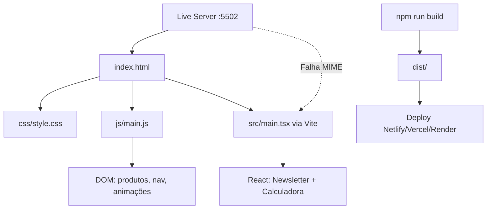

# Estrutura e Organização — Projeto Pharmadroga

Mapeamento da pasta raiz, dependências externas, contexto no workspace e proposta de reorganização profissional.

---

## 1. Contexto no filesystem

```
J:\area de trabalho\Fron_End\
└── Projetos\                          ← Pasta irmã (58+ projetos)
    ├── Projeto-Pharmadroga\           ← ESTE PROJETO (autocontido)
    ├── Projeto-PetShop\
    ├── Projeto-Saudemais\
    ├── MyHype\
    └── ... (demais projetos independentes)
```

**Observação:** Nenhum arquivo do Pharmadroga depende de pastas externas à sua raiz. O projeto é **100% autocontido** dentro de `Projeto-Pharmadroga/`.

---

## 2. Estrutura atual (raiz)

```
Projeto-Pharmadroga/
├── index.html              # Shell HTML — ponto de entrada
├── package.json            # Scripts Vite + dependências React
├── package-lock.json
├── vite.config.ts          # Alias @ → src/, porta 5173
├── tsconfig.json           # Strict TS — escopo: src/
├── tsconfig.node.json
├── .gitignore              # node_modules, dist, *.local
├── .vscode/
│   └── settings.json
│
├── css/
│   └── style.css           # Design system completo (~1136 linhas)
├── js/
│   └── main.js             # Lógica vanilla (produtos, nav, animações)
│
├── src/                    # Camada React + TypeScript
│   ├── main.tsx            # Entry React → #react-root
│   ├── App.tsx
│   ├── vite-env.d.ts
│   ├── components/
│   │   ├── NewsletterBanner.tsx
│   │   └── PaymentCalculator.tsx
│   ├── styles/
│   │   └── react.css
│   └── types/
│       └── index.ts
│
├── dist/                   # Build de produção (gerado)
│   ├── index.html
│   └── assets/
├── node_modules/           # Dependências npm
└── docs/                   # Documentação (esta auditoria)
    ├── README.md
    ├── AUDITORIA-COMPLETA.md
    ├── ESTRUTURA-E-ORGANIZACAO.md
    └── PLANO-IMPLEMENTACAO.md
```

---

## 3. Mapa de responsabilidades por camada

| Camada                     | Arquivos                      | Responsabilidade                           |
| -------------------------- | ----------------------------- | ------------------------------------------ |
| **Apresentação estática**  | `index.html`, `css/style.css` | Layout, seções, design tokens, responsivo  |
| **Interatividade vanilla** | `js/main.js`                  | Produtos, menu, scroll, contadores, reveal |
| **Interatividade React**   | `src/**`                      | Newsletter, simulador de parcelamento      |
| **Build**                  | `vite.config.ts`, `dist/`     | Bundling TSX, otimização produção          |
| **Tipos**                  | `src/types/index.ts`          | Contratos TS (parcialmente usados)         |

---

## 4. Fluxo de execução



---

## 5. Problemas estruturais identificados

| #   | Problema                                                                    | Risco                  |
| --- | --------------------------------------------------------------------------- | ---------------------- |
| 1   | Dois entry points (`js/main.js` + `src/main.tsx`) sem documentação clara    | Confusão de ambiente   |
| 2   | Dados de produtos só em `js/main.js`; tipos em `src/types` não reutilizados | Duplicação futura      |
| 3   | CSS split (`css/` vs `src/styles/`)                                         | Manutenção fragmentada |
| 4   | Sem `public/` para assets estáticos (imagens, favicon, OG image)            | SEO e marca limitados  |
| 5   | Sem README na raiz (corrigido nesta auditoria via `docs/`)                  | Onboarding difícil     |
| 6   | `index.html` referencia `/src/main.tsx` diretamente                         | Quebra fora do Vite    |

---

## 6. Estrutura proposta (padrão profissional)

Reorganização recomendada **sem alterar URLs públicas** após configuração Vite:

```
Projeto-Pharmadroga/
├── public/                     # Assets estáticos (copiados no build)
│   ├── favicon.svg
│   ├── og-image.png
│   └── robots.txt
│
├── index.html                  # Mantido na raiz (Vite convention)
│
├── src/
│   ├── main.tsx                # Único entry JS
│   ├── App.tsx
│   │
│   ├── assets/                 # Imagens importadas nos componentes
│   │
│   ├── components/
│   │   ├── layout/             # Header, Footer (futuro refactor)
│   │   ├── sections/           # Hero, Offers, Payment...
│   │   ├── NewsletterBanner.tsx
│   │   └── PaymentCalculator.tsx
│   │
│   ├── data/
│   │   └── products.ts         # Fonte única de produtos
│   │
│   ├── scripts/                # Lógica vanilla migrada
│   │   └── landing.ts          # ex-main.js
│   │
│   ├── styles/
│   │   ├── tokens.css          # Variáveis :root (extraídas de style.css)
│   │   ├── base.css            # Reset + tipografia
│   │   ├── components.css      # Cards, buttons, header...
│   │   ├── sections.css        # Hero, offers, payment...
│   │   ├── react.css
│   │   └── main.css            # @import aggregator
│   │
│   └── types/
│       └── index.ts
│
├── docs/                       # Documentação (mantida)
├── dist/                       # Build output (gitignored)
├── package.json
├── vite.config.ts
├── tsconfig.json
└── README.md                   # README principal na raiz
```

### Migração sugerida (ordem segura)

1. Criar `public/` e mover favicon/OG
2. Extrair `src/data/products.ts` e importar em `main.js` → depois `landing.ts`
3. Modularizar CSS em `src/styles/` sem mudar classes
4. Mover `js/main.js` → `src/scripts/landing.ts` e importar em `main.tsx`
5. Consolidar tudo no entry Vite; remover segundo `<script>` do HTML

---

## 7. Pastas externas — mapa de projetos irmãos

Projetos na mesma pasta `Projetos/` **não compartilham código** com Pharmadroga. Lista para referência organizacional:

| Projeto                       | Última modificação | Possível relação temática |
| ----------------------------- | ------------------ | ------------------------- |
| Projeto-Saudemais             | 07/08/2026         | Saúde / farmácia          |
| Projeto-PetShop               | 11/08/2026         | Varejo                    |
| Projeto-DahoraAtacadista      | 07/08/2026         | Varejo / preços           |
| Projeto-Mercadolar            | 08/08/2026         | Varejo                    |
| Projeto-BancoYona / SuperBank | 07/08/2026         | Pagamento / fintech       |
| Projeto-VivaPay               | 10/08/2026         | Pagamento                 |

**Recomendação:** manter Pharmadroga isolado. Se houver componentes reutilizáveis (design system, botões), extrair para pacote npm local ou monorepo no futuro — não copiar entre pastas.

---

## 8. Convenções de nomenclatura propostas

| Tipo              | Convenção     | Exemplo                  |
| ----------------- | ------------- | ------------------------ |
| Componentes React | PascalCase    | `PaymentCalculator.tsx`  |
| Scripts TS        | camelCase     | `landing.ts`             |
| CSS classes       | BEM           | `.offer-card__price`     |
| CSS tokens        | kebab-case    | `--color-teal-800`       |
| IDs de seção      | kebab-case PT | `#ofertas`, `#pagamento` |
| Docs              | UPPER-KEBAB   | `AUDITORIA-COMPLETA.md`  |

---

## 9. Git e artefatos

| Item                    | Deve versionar? | Status atual                          |
| ----------------------- | --------------- | ------------------------------------- |
| `node_modules/`         | Não             | `.gitignore` ok                       |
| `dist/`                 | Não             | `.gitignore` ok                       |
| `.vscode/settings.json` | Opcional        | Presente                              |
| `docs/`                 | Sim             | Criado nesta auditoria                |
| Screenshots Playwright  | Opcional        | `audit-*.png` na raiz do servidor MCP |

---

## 10. Ambientes de desenvolvimento

| Ambiente     | URL                              | React | Uso recomendado                  |
| ------------ | -------------------------------- | ----- | -------------------------------- |
| Vite dev     | `npm run dev` → `localhost:5174` | Sim   | **Desenvolvimento diário**       |
| Live Server  | `127.0.0.1:5502`                 | Não   | Apenas preview CSS/HTML estático |
| Vite preview | `npm run preview` → `:4174`      | Sim   | Teste pós-build                  |
| Produção     | `dist/`                          | Sim   | Deploy final                     |

Documentar no README da raiz para evitar confusão da equipe.
